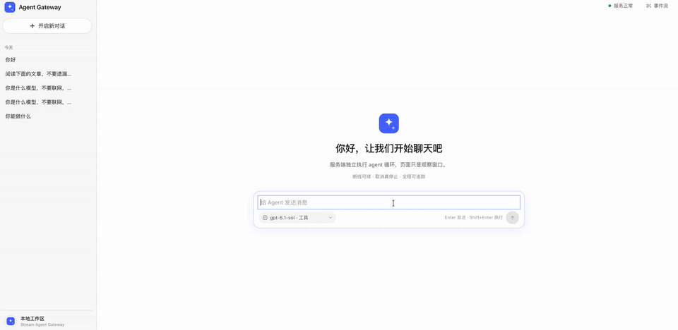

# go-agent-gateway

<p align="center">
  <a href="README.md">简体中文</a> · <a href="README.zh-TW.md">繁體中文</a> · <strong>English</strong> · <a href="README.ja.md">日本語</a> · <a href="README.ko.md">한국어</a>
</p>

<p align="center">
  <a href="https://agent-gateway.sudaqiang.vip/">Live demo</a> · <a href="handbook/tutorial/01-start.md">Tutorials</a> · <a href="#quick-start">Quick start</a> · <a href="handbook/development/README.md">Customization</a> · <a href="handbook/deployment.md">Deployment</a>
</p>

Learn **Agent tool calling, multi-turn context, SSE streaming, cancellation, retries, and event replay** through a runnable Go + Vue project.

This project grew out of the author's own Agent learning journey. It was designed by the author with AI assistance, and the initial code was written by AI. The open-source edition is for readers with basic programming experience who have not built an Agent before. All demo data is fictional. Licensed under [MIT](LICENSE).

This README is available in the five languages above. The detailed tutorials in `handbook/` are currently in Simplified Chinese.

## Live demo

Try the [live demo](https://agent-gateway.sudaqiang.vip/) to explore Agent conversations, tool calls, and SSE streaming.



<a id="quick-start"></a>

## Quick start: two paths

### Path A: install Go and explore a minimal Agent

Go 1.26.1 is recommended; the repository declares Go 1.22 as its language version. This example needs no database, containers, or model API keys:

```bash
git clone git@github.com:XuThreeFire/go-agent-gateway.git
cd go-agent-gateway
make agent-demo
```

Expect one `calc` tool call followed by a simulated answer containing `60`. On Windows, WSL is recommended. Without Make, run `go run ./backend/cmd/agent-demo '计算 (12+3)*4'` directly. Keep the Chinese example prompts as shown so they match the built-in mock model.

### Path B: run the full web gateway

Install Docker Desktop with Compose v2.24+ and start the Docker engine:

```bash
cp .env.example .env
docker compose up -d --build
```

The first run downloads images and dependencies. Open <http://127.0.0.1:8080> and sign in with username **gateway** and password **gateway-local-password**. These public example credentials are only for a local environment bound to the loopback interface.

Enter `计算 (12+3)*4` or `现在的时间`, then open “事件流” (Event stream) in the top-right corner to inspect model, tool, and terminal events. The default `demo` model is deterministic: it makes no provider requests and incurs no model charges. Real models may choose tools differently.

```bash
docker compose logs -f backend  # View logs
docker compose down            # Stop services, keep learning data
```

Use `make release` to generate a safe source archive instead of uploading an archive of your entire local directory. Never use the example password on a public deployment.

## Learning path

| Step | Tutorial | What you will do |
| --- | --- | --- |
| 1 | [Start from scratch](handbook/tutorial/01-start.md) | Run the project and understand its layout and two development setups |
| 2 | [The minimal Agent loop](handbook/tutorial/02-agent-loop.md) | Understand the model, tool declarations, and feeding results back |
| 3 | [Connect a real model](handbook/tutorial/03-models.md) | Configure your own provider and model |
| 4 | [Streaming and SSE](handbook/tutorial/04-streaming.md) | Inspect events and understand the two separate streams |
| 5 | [Tool calling](handbook/tutorial/05-tools.md) | Understand argument validation and error feedback |
| 6 | [Multi-turn conversations](handbook/tutorial/06-memory.md) | Understand history selection and context budgets |
| 7 | [Cancellation, retries, and recovery](handbook/tutorial/07-lifecycle.md) | Separate connection and execution lifecycles |
| 8 | [Reliability and cost](handbook/tutorial/08-reliability.md) | Run tests and understand the limits of the system's guarantees |

Continue with the [customization guide](handbook/development/README.md), [architecture and data model](handbook/reference/architecture.md), [HTTP/SSE contract](handbook/reference/protocol.md), and [personal deployment guide](handbook/deployment.md).

## Let's learn Agent development together

I started learning Agents one question and one debugging session at a time, too. By open-sourcing this project, I hope to share what worked and the pitfalls along the way, so more people can build an Agent of their own.

If you have questions while running the project, reading the source, or extending it, feel free to scan the QR code and add me on WeChat. An implementation you do not understand, an error you are stuck on, or an idea you want to try can all start a conversation. Your own experiments and lessons are welcome, too—let's improve the project together.

When adding me, include **“Agent 交流”** in your request, and I will invite you to the **Agent discussion group** on WeChat. We can discuss problems, share experience, and explore new ideas. I hope you leave with both a working project and people to keep learning with.


## Current scope

- A single-process, single-instance Go gateway; MySQL stores state, steps, usage, and events.
- A Vue browser client and a standalone HTTP/SSE CLI.
- Two read-only tools enabled by default: `now` and `calc`; a course-query extension is provided as a reference implementation.
- A mock model and Chat Completions-compatible interfaces; other protocols need separate adapters.
- File-based prompt hot reload, stable request construction, cache observability, and per-client and global daily token soft quotas; see [model runtime](handbook/reference/model-runtime.md).
- Signed cookies isolate browser identities; a personal public deployment also needs an access password and HTTPS.

The global daily soft quota defaults to 5 million tokens; set `quota.daily_tokens_global: 0` to disable it. Daily quotas and the per-Run token budget are soft limits checked against usage already reported by the provider. They cannot guarantee an exact billing cap. If a provider does not return usage, the gateway does not invent it. Force-killing the process may lose the last batch of events that has not yet been persisted. See the reliability tutorial for details.

## Development and verification

Native development requires Go, Node 24 LTS, Python 3, and a separate MySQL 8.4 instance. See the [startup tutorial](handbook/tutorial/01-start.md) for full instructions.

```bash
make doctor
make tools                # Install pinned tool versions into the project's bin/
make web-install
make test vet web-test web-build
make privacy-check
```

Run `make test-container` to automatically create, migrate, verify, and clean up an isolated MySQL test environment. A Docker engine is required. Native test database names must end in `_test`; see [CONTRIBUTING](CONTRIBUTING.md). CI runs migrations, MySQL integration tests, and container startup checks.

Public documentation lives in `handbook/`. Local `docs/`, `.local-docs/`, `data/`, `.env`, `dist/`, and editor state are excluded from the open-source deliverables.
