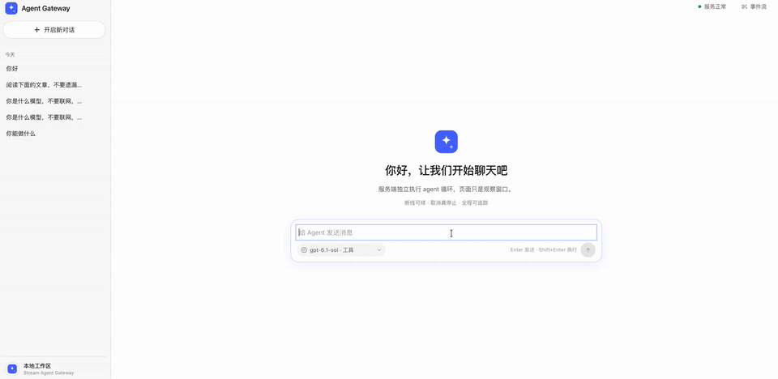
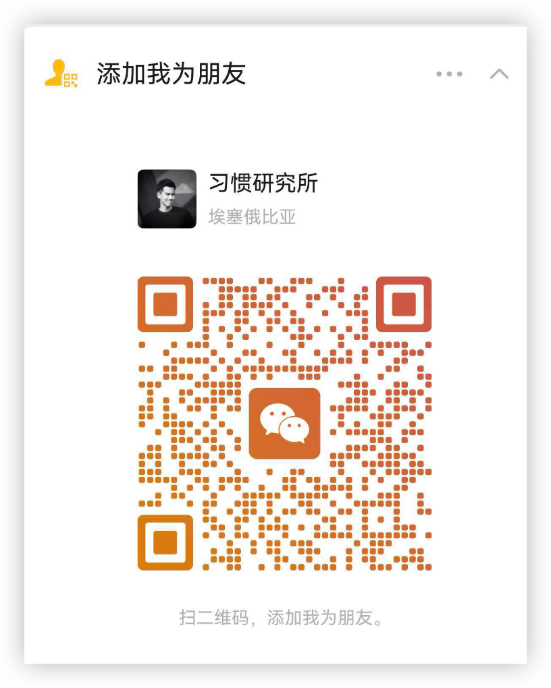

# go-agent-gateway

<p align="center">
  <a href="README.md">简体中文</a> · <a href="README.zh-TW.md">繁體中文</a> · <a href="README.en.md">English</a> · <strong>日本語</strong> · <a href="README.ko.md">한국어</a>
</p>

<p align="center">
  <a href="https://agent-gateway.sudaqiang.vip/">オンラインデモ</a> · <a href="handbook/tutorial/01-start.md">チュートリアル</a> · <a href="#quick-start">クイックスタート</a> · <a href="handbook/development/README.md">カスタマイズ</a> · <a href="handbook/deployment.md">デプロイ</a>
</p>

実際に動かせる Go + Vue プロジェクトを通じて、**Agent のツール呼び出し、複数ターンのコンテキスト、SSE ストリーミング、実行のキャンセル、再試行、イベントの再送**を学べます。

このプロジェクトは、作者が Agent を学ぶ中で生まれました。作者が AI の支援を受けて設計し、初版のコードは AI が作成しました。プログラミングの基礎知識はあるものの、Agent を開発したことがない方を対象としています。デモデータはすべて架空のものです。[MIT ライセンス](LICENSE)で公開しています。

README は上記の 5 言語に対応しています。`handbook/` の詳細なチュートリアルは、現在は簡体字中国語です。

## オンラインデモ

[オンラインデモ](https://agent-gateway.sudaqiang.vip/)で、Agent との対話、ツール呼び出し、SSE ストリーミングを体験できます。



<a id="quick-start"></a>

## クイックスタート：2 つの方法

### 方法 A：Go だけで最小構成の Agent を理解する

Go 1.26.1 を推奨します。リポジトリで宣言されている言語バージョンは Go 1.22 です。次のサンプルは、データベース、コンテナ、モデルの API キーなしで実行できます。

```bash
git clone git@github.com:XuThreeFire/go-agent-gateway.git
cd go-agent-gateway
make agent-demo
```

`calc` ツールが 1 回呼び出され、その後に `60` を含む模擬回答が表示されます。Windows では WSL を推奨します。Make がない場合は、`go run ./backend/cmd/agent-demo '计算 (12+3)*4'` を直接実行してください。組み込みの模擬モデルが認識できるよう、サンプルの入力文は中国語のまま使用してください。

### 方法 B：Web ゲートウェイ全体を起動する

Compose v2.24+ を含む Docker Desktop を用意し、Docker エンジンを起動します。

```bash
cp .env.example .env
docker compose up -d --build
```

初回起動時には、イメージと依存パッケージがダウンロードされます。<http://127.0.0.1:8080> を開き、ユーザー名 **gateway**、パスワード **gateway-local-password** でログインしてください。この公開サンプルの認証情報は、ループバックで待ち受けるローカル環境専用です。

`计算 (12+3)*4` または `现在的时间` を入力し、右上の「事件流」（イベントストリーム）を開くと、モデル、ツール、実行終了時のイベントを確認できます。デフォルトの `demo` は決定論的な模擬モデルで、プロバイダーへの通信やモデル利用料は発生しません。実際のモデルでは、ツールの選択が異なる場合があります。

```bash
docker compose logs -f backend  # ログを表示
docker compose down            # 停止する。学習用データは保持
```

ローカルディレクトリ全体を圧縮して公開せず、`make release` で公開用のソースアーカイブを生成してください。サンプルのパスワードを公開環境で使用しないでください。

## 学習の流れ

| 順序 | チュートリアル | 学ぶ内容 |
| --- | --- | --- |
| 1 | [ゼロから起動する](handbook/tutorial/01-start.md) | プロジェクトを動かし、ディレクトリ構成と 2 つの開発方法を理解する |
| 2 | [最小構成の Agent ループ](handbook/tutorial/02-agent-loop.md) | モデル、ツール定義、結果のフィードバックを理解する |
| 3 | [実際のモデルを接続する](handbook/tutorial/03-models.md) | 自分のプロバイダーとモデルを設定する |
| 4 | [ストリーミングと SSE](handbook/tutorial/04-streaming.md) | イベントを読み、独立した 2 つのストリームを理解する |
| 5 | [ツール呼び出し](handbook/tutorial/05-tools.md) | 引数の検証とエラーのフィードバックを理解する |
| 6 | [複数ターンの対話](handbook/tutorial/06-memory.md) | 履歴の選択とコンテキストの予算を理解する |
| 7 | [キャンセル・再試行・復旧](handbook/tutorial/07-lifecycle.md) | 接続と実行のライフサイクルを分けて考える |
| 8 | [信頼性とコスト](handbook/tutorial/08-reliability.md) | テストを実行し、システムが保証できる範囲を理解する |

続いて、[カスタマイズガイド](handbook/development/README.md)、[アーキテクチャとデータモデル](handbook/reference/architecture.md)、[HTTP/SSE の契約](handbook/reference/protocol.md)、[個人向けデプロイガイド](handbook/deployment.md)も参照してください。

## Agent 開発を一緒に学びましょう

私も、一つひとつの疑問とデバッグを通じて Agent を学び始めました。このプロジェクトを公開したのは、うまくいった方法やつまずいた経験を共有し、より多くの方が自分の Agent を作れるようになってほしいからです。

プロジェクトの実行、ソースコードの読解、機能拡張で疑問があれば、QR コードから WeChat で友だち追加してください。理解できない実装、解決できないエラー、試してみたいアイデアなど、どれも会話のきっかけになります。ご自身の実践や学びも、ぜひ共有してください。一緒にプロジェクトを改善していきましょう。

友だち申請には **「Agent 交流」** と記入してください。**Agent 交流グループ**に招待します。疑問の相談や経験、新しいアイデアの共有を通じて、動くプロジェクトだけでなく、一緒に学び続けられる仲間とも出会える場にしたいと思っています。



## 現在の対応範囲

- 単一プロセス・単一インスタンスの Go ゲートウェイ。状態、ステップ、使用量、イベントを MySQL に保存します。
- Vue のブラウザクライアントと、独立した HTTP/SSE CLI。
- デフォルトで `now` と `calc` の 2 つの読み取り専用ツールを有効化。講座検索ツールの拡張サンプルも提供しています。
- 模擬モデルと Chat Completions 互換インターフェース。その他のプロトコルには別途アダプターが必要です。
- ファイルによるプロンプトのホットリロード、安定したリクエスト生成、キャッシュの観測、クライアント単位と全体の日次 token ソフトクォータ。[モデル実行時の設定](handbook/reference/model-runtime.md)を参照してください。
- 署名付き Cookie でブラウザの識別情報を分離。個人で公開する場合は、アクセス用パスワードと HTTPS も必要です。

全体の日次ソフトクォータは、デフォルトで 500 万 token です。`quota.daily_tokens_global: 0` で無効にできます。日次クォータと Run ごとの token 予算は、プロバイダーから受信済みの使用量に基づくソフト制限であり、請求額の厳密な上限は保証しません。プロバイダーが usage を返さない場合、使用量を推測して記録することはありません。プロセスを強制終了すると、未保存の最後のイベントバッチが失われる可能性があります。詳細は信頼性のチュートリアルを参照してください。

## 開発と検証

ネイティブ環境での開発には、Go、Node 24 LTS、Python 3、独立した MySQL 8.4 が必要です。手順は[起動チュートリアル](handbook/tutorial/01-start.md)を参照してください。

```bash
make doctor
make tools                # 固定バージョンのツールをプロジェクトの bin/ にインストール
make web-install
make test vet web-test web-build
make privacy-check
```

`make test-container` は、独立した MySQL テスト環境の作成、マイグレーション、検証、クリーンアップを自動実行します。Docker エンジンが必要です。ネイティブ環境のテスト用データベース名は `_test` で終わる必要があります。[貢献ガイド](CONTRIBUTING.md)を参照してください。CI ではマイグレーション、MySQL 統合テスト、コンテナの起動確認を実行します。

公開ドキュメントは `handbook/` にあります。ローカルの `docs/`、`.local-docs/`、`data/`、`.env`、`dist/`、エディターの状態は公開対象に含まれません。
