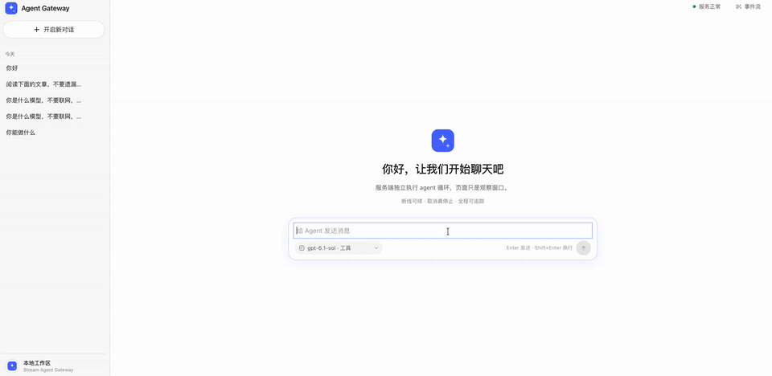
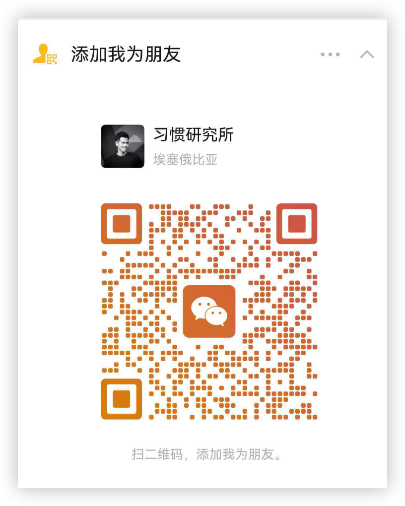

# go-agent-gateway

<p align="center">
  <a href="README.md">简体中文</a> · <a href="README.zh-TW.md">繁體中文</a> · <a href="README.en.md">English</a> · <a href="README.ja.md">日本語</a> · <strong>한국어</strong>
</p>

<p align="center">
  <a href="https://agent-gateway.sudaqiang.vip/">온라인 데모</a> · <a href="handbook/tutorial/01-start.md">튜토리얼</a> · <a href="#quick-start">빠른 시작</a> · <a href="handbook/development/README.md">기능 확장</a> · <a href="handbook/deployment.md">배포 가이드</a>
</p>

직접 실행할 수 있는 Go + Vue 프로젝트로 **Agent 도구 호출, 멀티턴 컨텍스트, SSE 스트리밍, 실행 취소, 재시도, 이벤트 재전송**을 배울 수 있습니다.

이 프로젝트는 작성자가 Agent를 공부하면서 떠올린 아이디어에서 시작했습니다. 작성자가 AI의 도움을 받아 설계했고, 초기 코드는 AI가 작성했습니다. 기본적인 프로그래밍 경험은 있지만 Agent를 개발해 본 적은 없는 독자를 위한 오픈 소스 프로젝트입니다. 모든 데모 데이터는 가상의 데이터입니다. [MIT 라이선스](LICENSE)로 배포합니다.

README는 위의 다섯 가지 언어로 제공됩니다. `handbook/`의 상세 튜토리얼은 현재 중국어 간체로 작성되어 있습니다.

## 온라인 데모

[온라인 데모](https://agent-gateway.sudaqiang.vip/)에서 Agent 대화, 도구 호출, SSE 스트리밍을 체험해 보세요.



<a id="quick-start"></a>

## 빠른 시작: 두 가지 방법

### 방법 A: Go만 설치하고 최소 Agent 이해하기

Go 1.26.1을 권장하며, 저장소에 선언된 언어 버전은 Go 1.22입니다. 아래 예제는 데이터베이스, 컨테이너, 모델 API 키 없이 실행할 수 있습니다.

```bash
git clone git@github.com:XuThreeFire/go-agent-gateway.git
cd go-agent-gateway
make agent-demo
```

`calc` 도구가 한 번 호출된 다음 `60`이 포함된 모의 응답이 출력됩니다. Windows에서는 WSL을 권장합니다. Make가 없다면 `go run ./backend/cmd/agent-demo '计算 (12+3)*4'`를 직접 실행하세요. 내장 모의 모델이 입력을 인식할 수 있도록 예제 프롬프트는 중국어 원문 그대로 사용하세요.

### 방법 B: 전체 웹 게이트웨이 실행하기

Compose v2.24+가 포함된 Docker Desktop을 설치하고 Docker 엔진을 실행하세요.

```bash
cp .env.example .env
docker compose up -d --build
```

처음 실행할 때는 이미지와 의존성을 다운로드합니다. <http://127.0.0.1:8080>에 접속해 사용자 이름 **gateway**, 비밀번호 **gateway-local-password**로 로그인하세요. 이 공개 예제 계정은 루프백 인터페이스에서만 수신하는 로컬 환경 전용입니다.

`计算 (12+3)*4` 또는 `现在的时间`을 입력하고 오른쪽 위의 “事件流”(이벤트 스트림)를 열면 모델, 도구, 실행 종료 이벤트를 확인할 수 있습니다. 기본 `demo` 모델은 결정론적 모의 모델로, 공급자에 요청을 보내지 않으며 모델 사용 요금도 발생하지 않습니다. 실제 모델의 도구 선택 방식은 다를 수 있습니다.

```bash
docker compose logs -f backend  # 로그 보기
docker compose down            # 서비스 종료, 학습 데이터 유지
```

로컬 디렉터리 전체를 압축해 업로드하지 말고, `make release`로 공개용 소스 패키지를 만드세요. 예제 비밀번호를 인터넷에 공개되는 환경에서 사용하지 마세요.

## 학습 순서

| 순서 | 튜토리얼 | 학습 내용 |
| --- | --- | --- |
| 1 | [처음부터 실행하기](handbook/tutorial/01-start.md) | 프로젝트를 실행하고 디렉터리 구조와 두 가지 개발 환경 이해하기 |
| 2 | [최소 Agent 루프](handbook/tutorial/02-agent-loop.md) | 모델, 도구 선언, 도구 결과를 모델에 다시 전달하는 과정 이해하기 |
| 3 | [실제 모델 연결하기](handbook/tutorial/03-models.md) | 자신의 공급자와 모델 설정하기 |
| 4 | [스트리밍과 SSE](handbook/tutorial/04-streaming.md) | 이벤트를 살펴보고 두 개의 독립적인 스트림 이해하기 |
| 5 | [도구 호출](handbook/tutorial/05-tools.md) | 인자 검증과 오류 피드백 이해하기 |
| 6 | [멀티턴 대화](handbook/tutorial/06-memory.md) | 대화 기록 선택과 컨텍스트 예산 이해하기 |
| 7 | [취소, 재시도, 복구](handbook/tutorial/07-lifecycle.md) | 연결과 실행의 수명 주기 구분하기 |
| 8 | [신뢰성과 비용](handbook/tutorial/08-reliability.md) | 테스트를 실행하고 시스템이 보장하는 범위 이해하기 |

이어서 [기능 확장 가이드](handbook/development/README.md), [아키텍처와 데이터 모델](handbook/reference/architecture.md), [HTTP/SSE 계약](handbook/reference/protocol.md), [개인 배포 가이드](handbook/deployment.md)를 읽어 보세요.

## Agent 개발을 함께 공부해요

저도 하나씩 질문하고 디버깅하면서 Agent를 배우기 시작했습니다. 이 프로젝트를 공개한 이유는 잘 동작했던 방법과 시행착오를 공유해, 더 많은 분이 자신만의 Agent를 직접 만들 수 있도록 돕고 싶어서입니다.

프로젝트 실행, 소스 코드 읽기, 기능 확장 과정에서 궁금한 점이 있다면 QR 코드를 스캔해 WeChat 친구로 추가해 주세요. 이해되지 않는 구현, 해결되지 않는 오류, 시도해 보고 싶은 아이디어 모두 대화의 출발점이 될 수 있습니다. 여러분의 구현 경험과 배운 점도 환영합니다. 함께 프로젝트를 개선해 나가요.

친구 신청 시 **“Agent 交流”**라고 적어 주시면 **Agent 교류 그룹**에 초대하겠습니다. 질문을 나누고 경험과 새로운 아이디어를 공유해요. 실행되는 프로젝트와 함께, 계속 공부할 동료도 만날 수 있기를 바랍니다.



## 현재 지원 범위

- 단일 프로세스, 단일 인스턴스 Go 게이트웨이. MySQL에 상태, 단계, 사용량, 이벤트를 저장합니다.
- Vue 브라우저 클라이언트와 독립적인 HTTP/SSE CLI.
- 기본으로 활성화된 읽기 전용 도구 `now`, `calc`. 강좌 조회 도구 확장의 참고 구현도 제공합니다.
- 모의 모델과 Chat Completions 호환 인터페이스. 다른 프로토콜은 별도 어댑터가 필요합니다.
- 파일 기반 프롬프트 핫 리로드, 안정적인 요청 구성, 캐시 관측, 클라이언트별 및 전체 일일 token 소프트 할당량. [모델 런타임](handbook/reference/model-runtime.md)을 참고하세요.
- 서명된 Cookie로 브라우저별 신원을 구분합니다. 개인 인스턴스를 인터넷에 공개하려면 접속 비밀번호와 HTTPS도 필요합니다.

전체 일일 소프트 할당량의 기본값은 500만 token이며, `quota.daily_tokens_global: 0`으로 비활성화할 수 있습니다. 일일 할당량과 Run별 token 예산은 공급자가 이미 보고한 사용량을 기준으로 확인하는 소프트 제한이므로, 정확한 청구 상한을 보장하지 않습니다. 공급자가 usage를 반환하지 않으면 사용량을 임의로 만들어 기록하지 않습니다. 프로세스를 강제 종료하면 아직 저장되지 않은 마지막 이벤트 배치가 유실될 수 있습니다. 자세한 내용은 신뢰성 튜토리얼을 참고하세요.

## 개발 및 검증

네이티브 환경에서 개발하려면 Go, Node 24 LTS, Python 3, 별도의 MySQL 8.4 인스턴스가 필요합니다. 전체 절차는 [시작 튜토리얼](handbook/tutorial/01-start.md)을 참고하세요.

```bash
make doctor
make tools                # 고정 버전의 도구를 프로젝트 bin/에 설치
make web-install
make test vet web-test web-build
make privacy-check
```

`make test-container`는 독립적인 MySQL 테스트 환경의 생성, 마이그레이션, 검증, 정리를 자동으로 수행합니다. Docker 엔진이 필요합니다. 네이티브 환경의 테스트 데이터베이스 이름은 반드시 `_test`로 끝나야 합니다. [기여 가이드](CONTRIBUTING.md)를 참고하세요. CI에서는 마이그레이션, MySQL 통합 테스트, 컨테이너 시작 검사를 실행합니다.

공개 문서는 `handbook/`에 있습니다. 로컬의 `docs/`, `.local-docs/`, `data/`, `.env`, `dist/`, 편집기 상태는 오픈 소스 배포 대상에 포함되지 않습니다.
