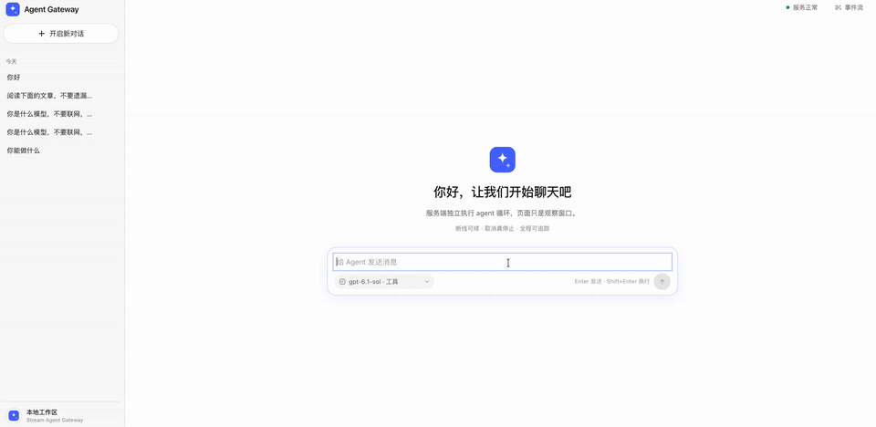

# go-agent-gateway

<p align="center">
  <a href="README.md">简体中文</a> · <strong>繁體中文</strong> · <a href="README.en.md">English</a> · <a href="README.ja.md">日本語</a> · <a href="README.ko.md">한국어</a>
</p>

<p align="center">
  <a href="https://agent-gateway.sudaqiang.vip/">線上展示</a> · <a href="handbook/tutorial/01-start.md">學習教學</a> · <a href="#quick-start">快速開始</a> · <a href="handbook/development/README.md">二次開發</a> · <a href="handbook/deployment.md">部署指南</a>
</p>

透過一個可執行的 Go + Vue 專案，學習 **Agent 工具呼叫、多輪對話脈絡、SSE 串流輸出，以及執行取消、重試和事件補發**。

專案源自個人學習 Agent 時的想法，由作者與 AI 輔助設計，初版程式碼由 AI 撰寫。開源版面向具備基本程式設計經驗、尚未開發過 Agent 的讀者；所有展示資料均為虛構資料。採用 [MIT 授權條款](LICENSE)。

README 提供以上五種語言版本；`handbook/` 中的詳細教學目前為簡體中文。

## 線上展示

造訪 [線上展示](https://agent-gateway.sudaqiang.vip/)，體驗 Agent 對話、工具呼叫和 SSE 串流輸出。



<a id="quick-start"></a>

## 先體驗：兩條路線

### 路線 A：只安裝 Go，理解最小 Agent

建議使用 Go 1.26.1；儲存庫宣告的語言版本為 Go 1.22。以下範例無需資料庫、容器或模型金鑰：

```bash
git clone git@github.com:XuThreeFire/go-agent-gateway.git
cd go-agent-gateway
make agent-demo
```

預期會看到一次 `calc` 工具呼叫，接著輸出包含 `60` 的模擬回答。Windows 建議使用 WSL；未安裝 Make 時，可直接執行 `go run ./backend/cmd/agent-demo '计算 (12+3)*4'`。範例提示詞保留簡體中文，以符合內建模擬模型的輸入。

### 路線 B：完整 Web 閘道

準備 Docker Desktop（包含 Compose v2.24+）並啟動引擎：

```bash
cp .env.example .env
docker compose up -d --build
```

首次啟動會下載映像檔與相依套件。開啟 <http://127.0.0.1:8080>，本機教學登入帳號為 **gateway**，密碼為 **gateway-local-password**。這些公開的範例值僅適用於監聽回環介面的本機環境。

輸入 `计算 (12+3)*4` 或 `现在的时间`，開啟右上角「事件流」，觀察模型、工具與終態事件。預設 `demo` 是確定性的模擬模型，不連線至供應商、不產生模型費用。真實模型選擇工具的行為可能不同。

```bash
docker compose logs -f backend  # 查看日誌
docker compose down            # 停止，保留學習資料
```

不要將整個本機目錄壓縮上傳；請使用 `make release` 產生安全的原始碼套件。不要將範例密碼直接用於公網。

## 學習路線

| 順序 | 教學 | 你將完成的內容 |
| --- | --- | --- |
| 1 | [從零啟動](handbook/tutorial/01-start.md) | 獨立執行，理解目錄與兩種開發方式 |
| 2 | [最小 Agent 迴圈](handbook/tutorial/02-agent-loop.md) | 理解模型、工具宣告與結果回傳 |
| 3 | [接入真實模型](handbook/tutorial/03-models.md) | 設定自己的供應商與模型 |
| 4 | [串流輸出與 SSE](handbook/tutorial/04-streaming.md) | 閱讀事件，理解兩個獨立的串流 |
| 5 | [工具呼叫](handbook/tutorial/05-tools.md) | 理解參數驗證與錯誤回饋 |
| 6 | [多輪對話](handbook/tutorial/06-memory.md) | 理解歷史訊息選取與脈絡預算 |
| 7 | [取消、重試與復原](handbook/tutorial/07-lifecycle.md) | 區分連線與執行的生命週期 |
| 8 | [可靠性與成本](handbook/tutorial/08-reliability.md) | 執行測試，理解系統保障的邊界 |

繼續閱讀[二次開發指南](handbook/development/README.md)、[架構與資料模型](handbook/reference/architecture.md)、[HTTP/SSE 契約](handbook/reference/protocol.md)及[個人部署指南](handbook/deployment.md)。

## 一起交流 Agent 開發

我也是從一個個問題、一次次除錯中開始學習 Agent 的。把這個專案開源，是希望分享走通的路與踩過的坑，讓更多人能親手做出自己的 Agent。

如果你在執行專案、閱讀原始碼或二次開發時遇到疑問，歡迎掃碼加我微信。一段看不懂的實作、一個卡住的錯誤，或一個想嘗試的點子，都可以成為交流的起點；也歡迎分享你的實作經驗，讓我們一起改善這個專案。

新增好友時請備註 **「Agent 交流」**，我會邀請你加入 **Agent 交流群**，一起討論問題、分享經驗與新想法。希望你收穫的不只是一個能執行的專案，還有一群可以一起探索的人。


## 目前範圍

- 單程序、單實例 Go 閘道；MySQL 儲存狀態、步驟、用量與事件。
- Vue 瀏覽器用戶端，以及獨立的 HTTP/SSE CLI。
- 預設啟用 `now`、`calc` 兩個唯讀工具；提供課程查詢擴充參考實作。
- 模擬模型與 Chat Completions 相容介面；其他協定需要另行適配。
- 檔案提示詞熱重載、穩定請求與快取觀測、用戶端及全域每日 token 軟配額；參閱[模型執行環境](handbook/reference/model-runtime.md)。
- 使用簽章 Cookie 隔離瀏覽器身分；個人公網部署還需存取密碼與 HTTPS。

全域每日軟配額預設為 500 萬 token（設定 `quota.daily_tokens_global: 0` 可關閉）。目前的每日配額與單次 Run token 預算，是依已收到的供應商用量檢查的軟限制，無法保證精確的帳單上限。供應商未回傳 usage 時不會虛構用量；強制終止程序可能遺失尚未持久化的事件尾批。詳細邊界請參閱可靠性教學。

## 開發與驗證

原生開發需要 Go、Node 24 LTS、Python 3，以及獨立的 MySQL 8.4。完整步驟請參閱[啟動教學](handbook/tutorial/01-start.md)。

```bash
make doctor
make tools                # 將固定版本工具安裝到專案 bin/
make web-install
make test vet web-test web-build
make privacy-check
```

執行 `make test-container` 可自動建立、遷移、驗證並清理獨立的 MySQL 測試環境；需要 Docker 引擎。原生測試資料庫名稱必須以 `_test` 結尾，詳見[貢獻指南](CONTRIBUTING.md)。CI 會執行遷移、MySQL 整合測試與容器啟動檢查。

公開文件均位於 `handbook/`。本機的 `docs/`、`.local-docs/`、`data/`、`.env`、`dist/` 與編輯器狀態不屬於開源交付內容。
