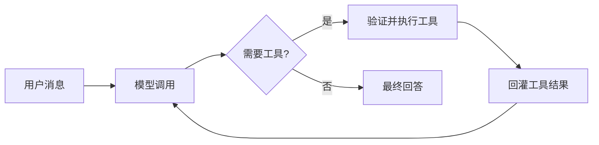

# 02 理解最小 Agent 闭环

目标：理解 Agent 比一次普通模型调用多做了什么。前置：完成第 01 章最小示例。

普通模型调用是“消息 → 模型 → 文本”。本项目的 Agent 会读取模型返回的工具请求，在服务端执行工具，将结果作为新消息交回模型，直到模型给出回答或触发预算限制。



## 阅读与操作

打开 `backend/cmd/agent-demo/main.go`，按下面顺序阅读：

1. `llm.New` 创建模型客户端，`tool.New` 注册工具。
2. `Spec()` 描述工具名称、用途和 JSON 参数。
3. `Stream` 返回文本和 `ToolCalls`。
4. 将带 `ToolCalls` 的 assistant 消息追加到历史。
5. 执行工具，将带相同 `ToolCallID` 的 tool 消息追加到历史。
6. 再次调用模型，直到没有工具请求。

```bash
go run ./backend/cmd/agent-demo '计算 2*21'
go run ./backend/cmd/agent-demo '你好'
```

第一条应调用计算器，第二条直接返回模拟文本。模拟模型通过固定规则选择工具，不代表真实模型有同样的确定性；后续接入真实模型后，工具选择由模型决定。

## 为什么必须回灌两种消息

第二次模型请求中应同时出现：

```text
user: 计算 2*21
assistant: tool_calls=[{id: demo-call, name: calc, arguments: ...}]
tool: tool_call_id=demo-call，content=2*21 = 42
```

模型只提出工具请求，实际执行发生在 Go 进程。缺少 assistant 的调用声明或对应的 `tool_call_id`，真实供应商通常会拒绝后续请求。

## 自己验证

```bash
go test ./backend/internal/exec -run TestLoopExecutesToolAndContinues -v
```

该测试断言第二次请求的消息结构，避免只看“最后算对了”就误认为 Agent 循环正确。

练习：输入 `计算 1/0`，观察错误如何作为工具结果返回。解释为什么参数错误可以交给模型纠正，而工具实现 panic 应当终止执行。参考第 05 章。常见误解是把模型生成的一段工具名称当成已执行工具；只有服务端调用 `Invoke` 才发生执行。

## 从单次调用逐步写成循环

先把最小示例的循环临时改成只调用一次 `client.Stream`：发送计算问题后只会收到 `ToolCalls`，得不到最终答案。这证明工具请求需要由你的程序执行。

再按下面两个片段补全消息。第一步保留模型的调用声明：

```go
messages = append(messages, domain.Message{
    Role: domain.RoleAssistant,
    Content: result.Content,
    ToolCalls: result.ToolCalls,
})
```

第二步执行并补入结果：

```go
output, err := tools.Run(ctx, call.Name, call.Arguments)
if err != nil {
    // 完整示例将业务错误编码成 JSON 后回灌。
    output = err.Error()
}
messages = append(messages, domain.Message{
    Role: domain.RoleTool,
    ToolCallID: call.ID,
    Name: call.Name,
    Content: output,
})
```

最后把调用放入有次数上限的循环：没有工具请求时结束，有工具请求时执行并继续。完整可运行版本在 `agent-demo/main.go`。先理解这三个变化，再阅读网关执行器中的持久化、SSE 和取消，可以避免把基础 Agent 逻辑与工程设施混在一起。
